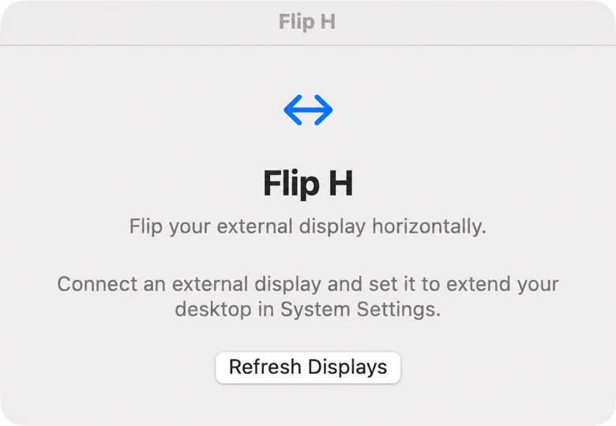
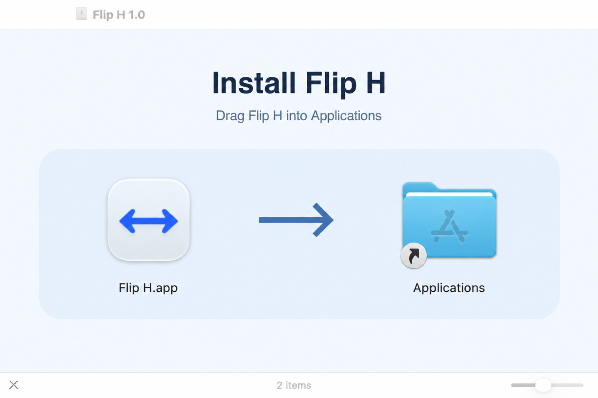

# Flip H

A small native macOS menu bar utility that horizontally flips an external display.
Useful for **teleprompters and screens viewed through a mirror**: the horizontal
flip compensates for the physical reflection, so text and interfaces appear the
right way around to the viewer. Use your usual prompting app, browser, or
presentation on the selected display.

Select an extended display and activate the mirror. To stop, choose **Turn Off
Mirroring** from the ↔ menu or the control window.
The built-in display and other monitors retain their normal presentation.

[**Download Flip H 1.0**](https://github.com/TheBeachLab/fliph/releases/latest)
— macOS 14+, Apple Silicon and Intel. Developer ID signed and notarized by Apple.



*Flip H's control window before an external display is connected.*

## Run

For a prebuilt copy, open the DMG from [GitHub Releases](https://github.com/TheBeachLab/fliph/releases)
and drag **Flip H** into **Applications**. The DMG supports Apple Silicon and Intel Macs with macOS 14 or later.



Launch **Flip H** from Applications. Flip H lives in the menu bar. Click the ↔ icon and
choose **Open Controls** to open the control window. Under **Language**, choose
English, German, French, Spanish, Catalan, Italian, or Portuguese. Flip H saves
your selection and applies it immediately. **System Language** is the default
and follows the macOS language preferences, with English as the fallback.

On first activation, allow **Flip H** in System Settings → Privacy & Security →
Screen & System Audio Recording, then reopen the app if macOS requests it. The
app captures video only and processes it locally. It has no network client,
recording output, or third-party dependencies.

An external screen must be configured as an extended display. Native macOS
mirror groups are excluded from the selector. The app starts with flipping off.
With one screen, the menu bar remains accessible during mirroring so you can stop it.

## Build and test

Requirements: macOS 14+ to run the app, and Xcode 26 or later to build the icon and app.

```sh
./script/build_and_run.sh          # Build, sign locally, and launch Flip H Dev
./script/build_and_run.sh --build  # Produce outputs/Flip H Dev.app
./script/build_and_run.sh --verify # Build, launch, and check the process
swift test --disable-sandbox
```

The Run action in `.codex/environments/environment.toml` uses the same script.
Local builds are named **Flip H Dev** and use the separate bundle identifier
`local.fran.fliph.dev`. Their ad-hoc signatures and screen-capture permissions
are independent of the installed release. The Run action only restarts the
development process. Rebuilding the development app may require its permission
to be granted again.

If an early development build used the release identifier, macOS may show screen
recording enabled while rejecting the installed app's different signing identity.
Quit Flip H, reset only its stale permission with
`tccutil reset ScreenCapture local.fran.fliph`, then add `/Applications/Flip H.app`
in System Settings → Privacy & Security → Screen & System Audio Recording.
Choose **Quit & Reopen** if prompted and turn mirroring on again.

To build a universal distribution DMG, install ImageMagick and uv, then pass a
Developer ID Application identity to `script/build_dmg.sh`. It uses dmgbuild to
lay out the Finder window, signs the app and disk image, and writes
`outputs/Flip-H-1.0.1.dmg` and the signed `outputs/Flip H.app`. The build
intermediate stays under `work/distribution/`; use the signed app for release testing.

Configure notarization once with an existing App Store Connect team API key.
The key's issuer UUID is different from the Developer Team ID. Keep the private
`.p8` file outside the repository; `notarytool` validates it and stores the
credentials in the macOS Keychain:

```sh
xcrun notarytool store-credentials FlipH \
  --key /secure/path/AuthKey_KEYID.p8 --key-id KEYID --issuer ISSUER_UUID
```

Submit the signed DMG and wait for `Accepted` before stapling and validating the
ticket. If the wait is interrupted, use `notarytool wait SUBMISSION_ID` with the
same profile to resume checking the existing submission.

```sh
xcrun notarytool submit outputs/Flip-H-1.0.1.dmg --keychain-profile FlipH --wait
xcrun stapler staple outputs/Flip-H-1.0.1.dmg
xcrun stapler validate outputs/Flip-H-1.0.1.dmg
codesign --verify --strict outputs/Flip-H-1.0.1.dmg
spctl --assess --type open --context context:primary-signature --verbose=2 outputs/Flip-H-1.0.1.dmg
```

Apple documents [API key authentication](https://developer.apple.com/documentation/technotes/tn3147-migrating-to-the-latest-notarization-tool)
and the [notarization workflow](https://developer.apple.com/documentation/security/customizing-the-notarization-workflow).

## Implementation

- SwiftUI owns the small control window and menu-bar menu.
- ScreenCaptureKit captures only the selected screen. The content filter excludes
  this app, which prevents feedback from the full-screen overlay.
- A single replaceable pixel buffer bounds memory and latency. Core Image renders
  the horizontal transform into a Metal-backed, non-activating AppKit panel at
  30 frames per second. All image processing stays on this Mac.
- The captured image includes a reflected arrow pointer drawn by the app. The
  system cursor is hidden only while it is over the selected screen and is
  restored on exit, screen changes, and display sleep.
- Input coordinates remain those of the original desktop, matching an H-flipped
  video output viewed through a physical mirror. The displayed pointer uses the
  standard arrow shape.
- Changes to the captured display's geometry, resolution, rotation or availability,
  transitions to or from a single-screen setup, display sleep, capture errors, and
  app termination stop the presentation and release resources. Repeated macOS
  screen notifications with unchanged capture configuration keep mirroring active.
  Capture must provide a complete frame before the overlay appears.

## Validation

Verified on 2026-11-08 on an Apple M1 Pro, macOS 27.0.1, with an extended HDMI
display at 1920 × 1080:

- Release build, local code signature, app launch, and HDMI selector.
- Pixel-level test with asymmetric colors: horizontal reversal, rows preserved.
- Test of nonzero input origin and Retina output scaling.
- Live capture started after screen-recording permission was granted.
- User confirmed the HDMI image was horizontally flipped.
- Stop button returned the UI to its inactive state.

Version 1.0.1 was also verified on 2026-11-10: all six tests passed, including
display-configuration regressions; the Developer ID update retained its renewed
screen-capture permission across installation and relaunch; and the user confirmed
the HDMI image was flipped. Apple accepted the universal DMG for notarization,
and both the app and stapled DMG passed Gatekeeper.

The graphics tests need access to macOS graphics services; a restricted runner
without that access can return empty Core Image output.

API references:

- https://developer.apple.com/documentation/screencapturekit
- https://developer.apple.com/documentation/screencapturekit/sccontentfilter
- https://developer.apple.com/documentation/coreimage/ciimage/transformed(by:)
- https://developer.apple.com/documentation/metalkit/mtkview
